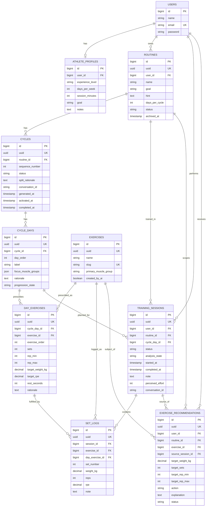

# Data model (ERD)

Source of truth: `database/migrations/` and the PHPDoc block on each model in
`app/Models/`. This page explains the *why* behind the tables; if a column here
disagrees with a migration, the migration wins — fix this page.

Conventions that apply to every domain table:

- `id` (bigint, internal, used for joins) **and** `uuid` (unique, the only id the
  API ever exposes — `HasPublicUuid` trait). Route-model binding is by `uuid`.
- Enums are stored as strings and cast to backed PHP enums (`app/Enums/`).
- Money-like numbers are `decimal`, never float: `weight_kg` is `decimal(6,2)`,
  `rpe` is `decimal(3,1)`.

## Diagram



Reading notes:

- Nullable foreign keys: `training_sessions.cycle_day_id` (null means a free
  session), `set_logs.day_exercise_id` (null means an off-plan set) and
  `exercise_recommendations.source_session_id`.
- The real column behind `day_order` and `exercise_order` is named `order` in
  both tables; it is renamed here only because `order` is a reserved word in
  diagram syntax.

### Constraints that are not visible in the diagram

| Table | Constraint |
|---|---|
| `athlete_profiles` | `user_id` unique (one profile per user) |
| `routines` | partial unique index on `user_id` where `status = 'active'` (one active routine per user) |
| `cycles` | unique `(routine_id, sequence_number)` |
| `cycle_days` | unique `(cycle_id, order)` |
| `day_exercises` | unique `(cycle_day_id, order)` |
| `training_sessions` | partial unique index on `user_id` where `status = 'in_progress'` (one open session per user) |
| `set_logs` | unique `(session_id, exercise_id, set_number)` |
| `exercise_recommendations` | unique `(user_id, routine_id, exercise_id)` |

Enum values: `routines.status` = active, archived · `cycles.status` = generating,
draft, active, completed, incomplete, failed · `cycle_days.progression_state` =
pending, ai, fallback, unchanged · `training_sessions.status` = in_progress,
completed · `training_sessions.analysis_state` = pending, processing, done,
failed · `exercise_recommendations.status` = active, applied ·
`exercise_recommendations.action` = advance_weight, hold, add_reps, add_set,
deload, technique_focus · `athlete_profiles.experience_level` = beginner,
intermediate, advanced.

Not in the diagram (framework tables): `password_reset_tokens`, `sessions`
(Laravel's session store, which is why the domain table is called
`training_sessions`), `cache*`, `jobs`/`job_batches`/`failed_jobs` (the `database`
queue driver) and `agent_conversations` / `agent_conversation_messages`
(written by `laravel/ai`; `cycles.conversation_id` and
`training_sessions.conversation_id` point at them as a trace only — no FK).

## Aggregate map (how to think about it)

| Aggregate | Root | Children | Notes |
|---|---|---|---|
| Account | `users` | `athlete_profiles` | Profile is 1:1 and is the AI's input about the athlete. |
| Program | `routines` | `cycles` → `cycle_days` → `day_exercises` | The *plan*. Written by the AI, then (cycle N+1) by cloning. |
| Execution | `training_sessions` | `set_logs` | What the user *actually did*. Never written by the AI. |
| Feedback | `exercise_recommendations` | — | Written by the AI after a session; read by the next cycle. |
| Catalogue | `exercises` | — | Global, shared by all users, owned by nobody. |

The plan (Program) and the execution (Execution) only meet through two soft
links: `training_sessions.cycle_day_id` and `set_logs.day_exercise_id`. Both are
nullable on purpose — see "Free sessions" below.

## Tables

### `users`
Standard Laravel auth table. Auth is Sanctum **SPA mode** (cookie + CSRF), not
tokens. Deleting a user cascades to everything they own.

### `athlete_profiles`
`user_id` is `UNIQUE`: exactly one profile per user, created/updated by
`PUT /profile` (`updateOrCreate`). `notes` is passed to the AI verbatim, so it is
where injuries, equipment limits and preferences live. A profile is a
**precondition** for creating a routine (`PROFILE_INCOMPLETE`, 409).

### `routines`
A training program. A user has many but **at most one `active`**:

- Partial unique index `routines_user_id_active_unique (user_id) WHERE status='active'`
  is the DB backstop. The normal path never hits it: `RoutineCreateAction`
  archives the incumbent inside the same transaction that inserts the new one.
- `archived` is permanent and read-only; there is no "unarchive" and no manual
  "archive" action — archiving is only ever a side effect of creating a new routine.
- `goal` belongs to the routine and is independent of `athlete_profiles.goal`.

### `cycles`
One week of a routine. `(routine_id, sequence_number)` is unique; cycle 1 is
created with the routine, cycle N+1 by `POST /routines/{routine}/cycles`.
`Routine::cycle()` is "latest by sequence_number"; `Routine::activeCycle()` is
"the one with status `active`" — use the right one.

Status lifecycle (see `docs/flows.md` §Cycle generation for who moves it):

```
            (first cycle)                         (rollover)
 ─────────────────────────► active ─────────────────────────► completed   all 5 days trained
                              ▲                  └──────────► incomplete  rolled over early
 generating ── finalize ──────┘
     └──── a job exhausts its retries ──► failed   (deleted by the next generate call)
 draft   reserved, unused
```

At any moment a routine has **at most one `active` and at most one `generating`**
cycle; `CycleGenerateAction` enforces the second with a guard
(`CYCLE_GENERATION_IN_PROGRESS`) and uses `sole()` for the first (an invariant
violation, not a handled case).

### `cycle_days`
Day `order` 1..5 of a cycle. Not tied to a calendar weekday — the user trains at
their own pace. `focus_muscle_groups` is a JSON array of `MuscleGroup` values.
`progression_state` only matters while a cycle is `generating`:
`pending` → `ai` | `fallback`; `unchanged` is a day nothing was trained on (copied,
never sent to the AI) and the default everywhere else.

### `day_exercises`
The **prescription**: sets, rep range, target weight/RPE, rest and a rationale
for one exercise on one day. `(cycle_day_id, order)` is unique.
`exercise_id` is `RESTRICT`: the catalogue is permanent, a prescription can never
delete an exercise. `target_weight_kg` is nullable in the schema but the
first-cycle planner always requires a value.

### `exercises`
The global catalogue. Today it is filled **lazily by the AI**:
`ExerciseCatalogService::resolve()` slugifies the free-text name the planner
returned and inserts it (`created_by_ai = true`) if the slug is new. There is no
alias table — semantic duplicates ("Bench Press" vs "Barbell Bench Press") are
only logged. `slug` is the identity used by the xlsx import to match rows.
(See `docs/design/exercise-catalog-i18n-wod-design.md` for the planned
replacement by a curated dataset.)

### `training_sessions`
A workout the user actually executed.

- `cycle_day_id` **nullable** → a *free session* (off-plan). `nullOnDelete`.
- At most one `in_progress` session per user: partial unique index
  `training_sessions_user_in_progress_unique (user_id) WHERE status='in_progress'`
  (backstop; `TrainingSessionOpeningService` returns a clean 409 first).
- `status`: `in_progress` → `completed` (one-way).
- `analysis_state` is independent of `status`: the session is `completed` the
  moment the user closes it, even if the AI analysis later fails.
  `pending` → `processing` → `done` | `failed`.
- `perceived_effort` is 1–5 for the whole session; `note` is free text. Both are
  fed to the analyst agent.
- `user_id` is denormalised (it is derivable through `routine`) so ownership
  checks and "does this user have an open session" are single-table queries.

### `set_logs`
One performed set. Unique `(session_id, exercise_id, set_number)`; set numbers
must be contiguous per exercise within a session (`NON_CONTIGUOUS_SET_NUMBER`).
`exercise_id` is always filled; `day_exercise_id` is filled only when the set
was logged against a prescription (otherwise it is an off-plan set). The two
are consistent by construction: when a `day_exercise_id` is sent, the
`exercise_id` is taken from it.

### `exercise_recommendations`
The AI's "next time do this" for **one exercise within one routine for one user**:
unique `(user_id, routine_id, exercise_id)`. It is *replaced in place*
(`updateOrCreate`) every time that exercise is analysed, so there is one current
row, not a history; trends come from `set_logs`, not from this table.
`source_session_id` is traceability only. `status`:

- `active` — a pending target, not yet folded into a generated cycle;
- `applied` — a cycle rollover consumed it. A fresh analysis flips it back to
  `active`.

## Deletion & integrity rules at a glance

| Relation | On delete | Why |
|---|---|---|
| anything → `users` / `routines` | CASCADE | Deleting an account/routine removes its history. |
| `day_exercises.exercise_id`, `set_logs.exercise_id`, `exercise_recommendations.exercise_id` | RESTRICT | The catalogue is permanent. |
| `training_sessions.cycle_day_id` | SET NULL | Deleting a failed/old cycle must not delete sessions; they become free sessions. |
| `set_logs.day_exercise_id` | SET NULL | Same: the set survives its prescription. |
| `exercise_recommendations.source_session_id` | SET NULL | Traceability only. |
| `training_sessions` DELETE (API) | allowed only if `in_progress` | `DELETE /sessions/{id}` exists to unblock a stuck open session; completed history is immutable. |

## Derived data (nothing is stored)

These are computed on read; do not look for columns:

- **Session `summary`** (`exercises_count`, `sets_count`, `total_volume_kg`,
  `duration_seconds`, `volume_change_pct`) — `SessionSummaryService`, computed for a
  whole page in a fixed number of queries. `volume = Σ weight_kg × reps`.
  `volume_change_pct` compares with the latest completed session of the same
  routine on the same day `order` in the *previous* cycle; `null` for cycle 1,
  free or in-progress sessions, or a zero baseline.
- **`previous`** on each prescribed exercise and **`history`/trend** on each
  recommendation — `ExerciseHistoryService`, from the user's completed sessions.
- **Progression summary** (prescribed vs actual, trend up/down/flat, plateau
  signal) — `ProgressionSummaryService`, pure PHP, fed to the progression agent.
