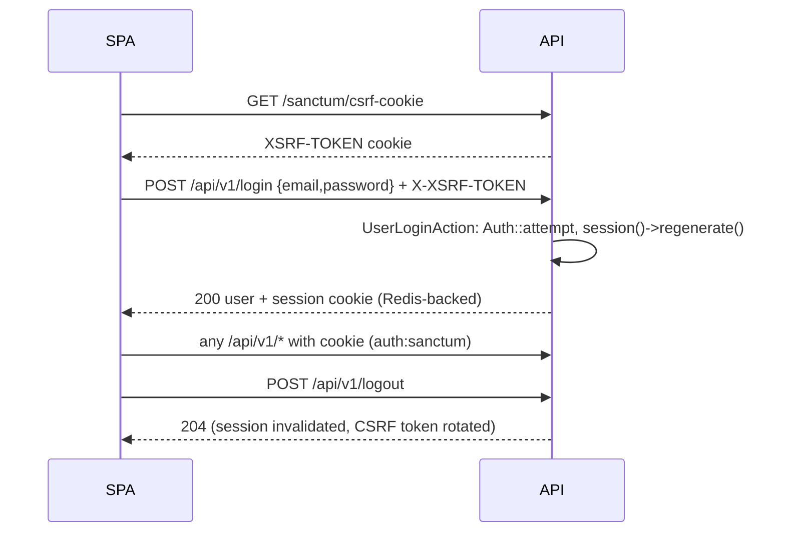
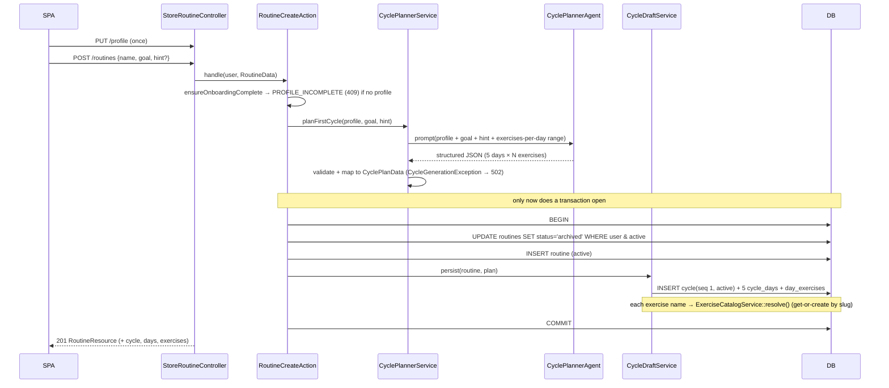
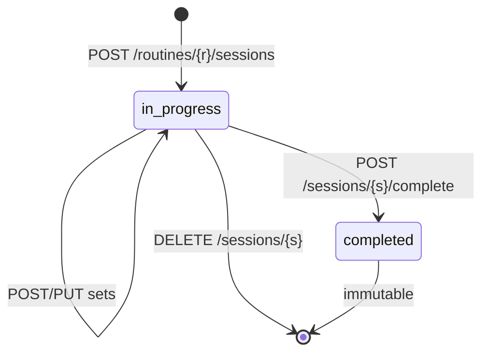
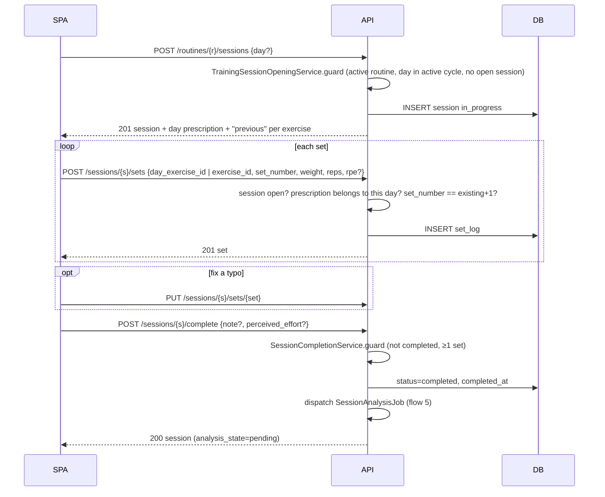
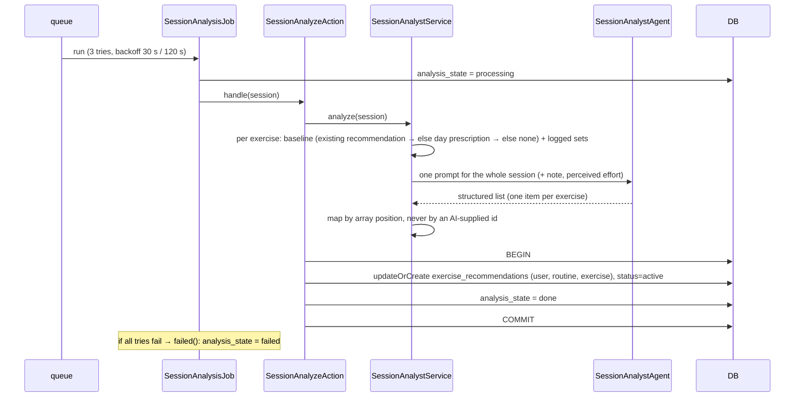
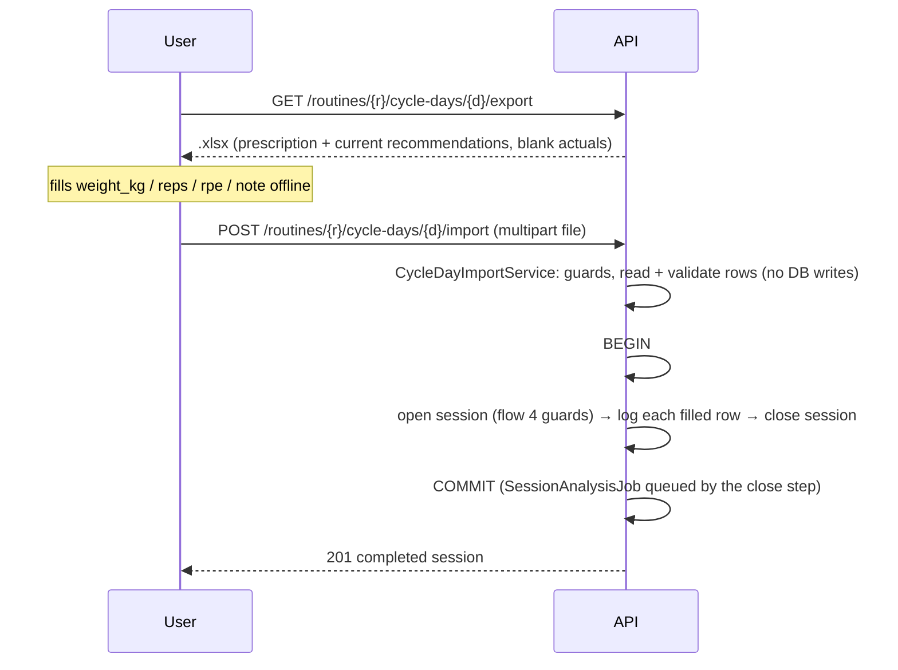

# Flows

Step-by-step behaviour of every multi-step flow, with the class that owns each
step. Use-case level descriptions (inputs, errors) are in `docs/use-cases.md`;
tables are in `docs/DER.md`.

The layering every flow follows (from `CLAUDE.md`):

```
Form Request ─► invokable Controller ─► Action ─► Service(s) ─► JSON Resource
 (shape +        (HTTP status only)     (transactions,   (business rules,
  Policy)                                jobs, orchestration) AI, I/O)
```

Two rules explain most of the code you will read below:

1. **Only Actions open transactions and dispatch jobs.** Services are called
   *into*; they never dispatch or call Actions.
2. **No AI call ever runs inside a DB transaction.** Every flow that uses the AI
   calls it first, then opens the transaction to persist the result.

---

## 1. Authentication (Sanctum SPA mode)



- Cookie auth, not bearer tokens. The SPA and API must share a registrable
  domain (production serves both from one origin on purpose).
- `SANCTUM_STATEFUL_DOMAINS` must list the SPA's origin or requests are treated
  as stateless and every call is a 401.
- `register` and `login` are throttled `6/min`.

## 2. Onboarding → first routine (the only synchronous AI flow)



What the planner enforces (`CyclePlannerService::mapPlan` + prompt):

- exactly 5 days; every day has the same number of exercises, inside the range
  for the athlete's experience level (`config/training.php`, env
  `CYCLE_EXERCISES_PER_DAY_*`: beginner 3–5, intermediate 4–6, advanced 6–8);
- `rep_min ≤ rep_max`, non-negative `target_weight_kg`, `target_rpe` 0–10,
  every muscle group in the `MuscleGroup` enum, ≥1 focus group per day.

The **recovery rule** (adjacent days must not share a muscle group; a group is
not retrained before day N+3) is only a *prompt instruction* — the code does not
verify it. If you see a plan that violates it, that is a model compliance issue,
not a bug in validation.

Failure semantics: the AI call precedes the transaction, so a failure leaves
**no trace** (no routine, and the old active routine is not archived). The
client retries the same POST. The agent has a 60 s timeout and `MaxTokens(7000)`
— both matter on rate-limited provider tiers (see the comment in
`CyclePlannerAgent`).

## 3. Cycle generation (cycle N+1, asynchronous)

The most intricate flow. The key idea: **cycle N+1 keeps the exercises of cycle
N**; the AI only re-prescribes load/volume for exercises that were actually
trained.

```mermaid
sequenceDiagram
    participant SPA
    participant A as CycleGenerateAction
    participant Q as queue
    participant J1 as CycleDayProgressionJob (per trained day)
    participant PA as CycleDayProgressAction
    participant AI as CycleProgressionAgent
    participant J2 as CycleFinalizeJob
    participant DB

    SPA->>A: POST /routines/{r}/cycles   (throttle 1/min, RoutinePolicy::generateCycle)
    A->>A: ensureCanGenerate: routine active? none generating? → sole active cycle
    A->>A: ProgressionSummaryService.summarize + performedSlots
    A->>DB: BEGIN
    A->>DB: DELETE routine's failed cycles
    A->>DB: INSERT cycle N+1 status=generating
    A->>DB: clone all days+exercises of cycle N (cloneDays → persistDays)
    A->>DB: trained days → progression_state='pending'
    A->>DB: COMMIT
    A->>Q: Bus::chain([ day jobs (60 s apart)…, Finalize ])
    A-->>SPA: 202 cycle (generating)

    loop each pending day
        Q->>J1: run
        J1->>PA: handle(day, isLastAttempt)
        PA->>AI: progress performed slots (prompt: prescribed vs actual, trend, plateau, recommendation)
        alt AI ok
            PA->>DB: applyProgressions; day.progression_state='ai'
        else AI fails and attempts < 3
            PA-->>Q: rethrow → retry after 60 s
        else AI fails on the last attempt
            PA->>DB: progressionsFromRecommendations; state='fallback'
        end
    end
    Q->>J2: run
    J2->>DB: new cycle → active (+ split_rationale text)
    J2->>DB: outgoing → completed (all 5 days trained) | incomplete
    J2->>DB: recommendations of trained exercises → status 'applied'
    SPA->>SPA: polls GET /routines/{r} until cycle is active
```

Details worth knowing:

- **What is "trained"?** An exercise counts as performed if at least one set of
  it was logged in a completed session of the outgoing cycle's days
  (`ProgressionSummaryService`). Slots not performed are copied verbatim and never
  reach the AI. A day with no performed slots stays `unchanged` and has no job.
- **Why one job per day, 60 s apart?** To fit small provider rate limits
  (token-per-minute). In production the queue runs as a short job every ~2 min
  (see `operations.md`), so a full rollover takes roughly 5–10 minutes.
- **Failure handling:** a day job that exhausts retries *without* going through
  its fallback (e.g. it crashes), or a finalize job that fails 3 times, sets the
  cycle to `failed` (`failed()` hooks). The outgoing cycle stays `active`, so the
  user is never left without a plan; the next `POST …/cycles` deletes the failed
  cycle and starts over.
- **Idempotency:** `CycleDayProgressAction` returns immediately if the day is no
  longer `pending`; `CycleFinalizeAction` returns immediately if the cycle is no
  longer `generating`. Re-delivered jobs are safe.
- **Concurrency guard:** a second request while one is `generating` gets
  `CYCLE_GENERATION_IN_PROGRESS`.

## 4. Training session lifecycle





Rules:

- **One open session per user** (service guard + partial unique index).
- **Planned vs free:** a session with a `day` is *planned* (`cycle_day_id` set);
  without it, *free*. Planned sessions get prescriptions, `previous` and
  `volume_change_pct`; free sessions only accept sets by `exercise_id`.
- **A day is "done"** when ≥1 session against it is `completed`. A cycle is
  `completed` at rollover only if all 5 of its days are done (free sessions never
  count).
- The set sequence is **strictly contiguous per exercise**: the client sends
  `n+1` where `n` is the number of sets already stored for that exercise.

## 5. Session analysis (AI recommendations)



- The recommendation `action` is one of `advance_weight | hold | add_reps |
  add_set | deload | technique_focus`.
- **Matching by position:** the service sends the exercises in a fixed order and
  maps results back by index, so the model can't attach advice to the wrong
  exercise by hallucinating an id. A wrong count is a `SessionAnalysisException`.
- A failed analysis **does not roll back or block** the session. It is retried by
  the scheduled command (flow 6) three times a day.

## 6. Retry of failed analyses

`sessions:retry-failed-analysis` (scheduled `0 8,14,20 * * *`, no overlap) →
`SessionAnalysisRetryAction` → selects sessions with `analysis_state = failed` →
dispatches `SessionAnalysisJob` for each. Logs `found`/`requeued` counts.

## 7. Spreadsheet export / import (offline logging)



- Reading and validating the workbook happens **before** the transaction, so a
  bad file never leaves a half-created session; if anything fails inside, the
  whole thing rolls back.
- Exercises in the sheet are matched to the day's prescriptions by
  `Str::slug(name)` — if you ever rename or restructure the exercise catalogue,
  this matching is a dependency.
- Rows missing weight **or** reps are skipped (not errors).

## 8. Reads that compute things on the fly

- **Session summary** → `SessionSummaryService::attach()` is called by the
  list/show/create/complete Actions to set a non-persisted `summary` relation.
- **Previous performance / trend** → `ExerciseHistoryService`
  (`attachPrevious`, `attachTrend`, `pageFor`).
- **Current recommendations** → `RecommendationCatalogService::listCurrentForRoutine`
  (scoped to the routine's current cycle).

When a Resource shows a number the DB has no column for, it comes from one of
these. Add new derived fields there, not as columns.

---

## State reference

| Entity | Field | Values | Moved by |
|---|---|---|---|
| Routine | `status` | `active` → `archived` | `RoutineCreateAction` (archives the incumbent) |
| Cycle | `status` | `generating` → `active` → `completed`/`incomplete`; `generating` → `failed`; (`draft` unused) | `CycleGenerateAction`, `CycleFinalizeAction`, job `failed()` |
| CycleDay | `progression_state` | `unchanged` (default), `pending` → `ai`/`fallback` | `CycleGenerateAction`, `CycleDayProgressAction` |
| TrainingSession | `status` | `in_progress` → `completed` | `SessionCloseAction` |
| TrainingSession | `analysis_state` | `pending` → `processing` → `done`/`failed` | `SessionAnalysisJob` |
| ExerciseRecommendation | `status` | `active` ⇄ `applied` | `SessionAnalyzeAction` (→ active), `CycleFinalizeAction` (→ applied) |
